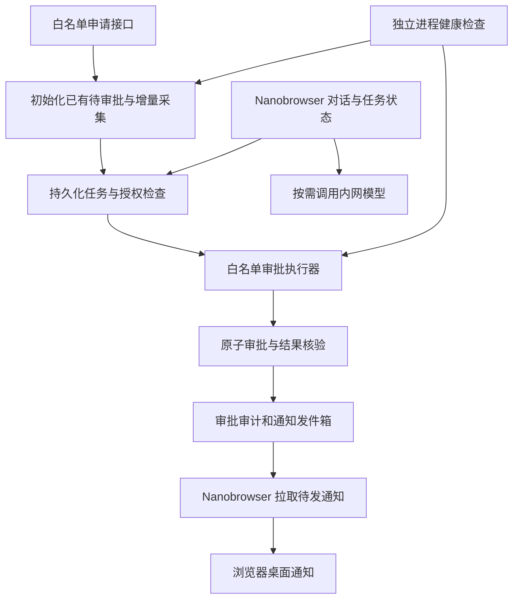

# SuperAgent 调研与白名单自动审批方案

调研日期：2026-11-02。目标：启用后自动同意指定平台已有和新增的待审批白名单申请，并通过浏览器桌面通知提示你。模型、申请数据、任务记录和通知均留在公司内网；沿用 Linux x64 部署条件。

用户已确认：通知渠道为浏览器桌面通知；处理范围为已有和新增的待审批申请全部通过。

源码基线：Nanobrowser `19dc8e8a9be6ed06c0ef9ec7de8d84bf6a88c458`；dbgpt 的 HEAD 为 `9869d60a3e343619bf3088711518370585c9db61`，本次分析包含其工作区已有修改，并非只分析提交版本。

本次完成官方资料和本地源码调研，给出实施设计。本文中的新工具、任务调度、自动审批策略和验收指标均为拟实施内容，当前没有开启监测或执行实际审批。

## 1. 建议采用的路线

建议采用“内网常驻调度服务＋白名单业务工具＋持久化任务状态＋浏览器桌面通知”的结构。Nanobrowser 提供对话、桌面通知和人工查看页面的入口。固定的自动通过规则由程序执行，模型按需理解用户指令、解释状态和组织结果。

这满足你要的页面业务结果：审批后的白名单、申请状态和页面显示都会变化。这里监测的是该页面使用的业务接口。若你要求每次审批必须实际打开页面、定位按钮并点击，则选择第 5 节的浏览器方案；两条路线分别实现，不在接口出错时自动切换为浏览器点击。

你的当前需求只有一个明确任务，第一阶段可以配置一个执行器，并发设为 1。以后增加其他平台任务，再扩展统一路由和多个隔离执行器。

## 2. DeepSeek 的 SuperAgent 到底是什么

需要分清三个层次：

| 层次 | 已核实的含义 | 对本项目的意义 |
| --- | --- | --- |
| DeepSeek 模型 | 为系统提供理解和工具调用能力 | 使用公司内网部署的模型服务；本任务以文本和结构化数据为主 |
| DeepSeek Harness（DSH） | DeepSeek 开源的插件化 Agent 运行框架，目前处于预览阶段 | 可以作为服务器端 Agent 宿主，但要验证插件与模型接口兼容性 |
| dsh-superagent-prototype | 运行在 DSH 上的主动编程 Agent 研究原型 | 可以借鉴其事件、授权、任务和恢复机制；需要开发平台适配器 |

官方将 DSH 描述为基于 Cordis 的插件化框架，并提示预览阶段存在兼容性变化。[DSH 官方介绍](https://www.deepseek.com/harness/en/)、[DSH 官方仓库](https://github.com/deepseek-ai/deepseek-harness/blob/master/README.md)。

本次核对的 SuperAgent 原型版本为 `0.1.0`，提交为 `6337fc823ce20251c8de8085948165c81aaa701e`，提交时间为 2026-10-31。它主要监听一个 GitHub 仓库，可选接入飞书；收到获授权的任务后，在独立会话和目录中执行。仓库采用 MIT 许可，并明确说明它是研究原型，部分文章中的设计尚未实现。[原型说明](https://github.com/deepseek-ai/dsh-superagent-prototype/blob/6337fc823ce20251c8de8085948165c81aaa701e/README.md)、[版本与依赖](https://github.com/deepseek-ai/dsh-superagent-prototype/blob/6337fc823ce20251c8de8085948165c81aaa701e/package.json)。

因此，“使用 DeepSeek 模型”不会自动获得长期监测能力。持续运行来自模型之外的事件接收、任务调度、持久化和恢复机制。

### 可直接借鉴的设计

官方领域模型的流程是：Source 产生 Trigger，经过授权评估形成带有 Mandate 的 Ticket，由 Assignment 交给 Executor，结果通过 Channel 返回。[官方领域模型](https://github.com/deepseek-ai/dsh-superagent-prototype/blob/6337fc823ce20251c8de8085948165c81aaa701e/docs/001-domain.md)。

在你的场景中，可映射为：

| SuperAgent 概念 | 白名单场景中的对应物 |
| --- | --- |
| Source | 白名单申请接口，或平台提交申请时产生的内部事件 |
| Trigger | 一条已有待审批申请的初始化事件或新增申请事件，包含稳定的申请 ID、工号、提交时间和版本 |
| Thread | 同一条申请后续的状态变化 |
| Policy / Mandate | 你启用的“指定平台已有及新增待审批申请自动同意”规则及其授权范围 |
| Ticket | 对某一条申请执行一次审批的持久化任务 |
| Executor / Worker | 调用限定的审批工具，或在指定页面执行审批 |
| Channel / Outbox | 服务端通知发件箱，经 Nanobrowser 展示为浏览器桌面通知 |
| Router / 主会话 | 接收对话和状态查询；任务变多后负责分派 |

官方把确定性准入和模型研判分开；消息和页面文本不能修改授权。你的申请理由即使包含“忽略限制、访问其他网站”等内容，也只能作为申请数据。[官方授权设计](https://github.com/deepseek-ai/dsh-superagent-prototype/blob/6337fc823ce20251c8de8085948165c81aaa701e/docs/002-authorization.md)。

官方执行设计还包含持久化后执行、工作槽位、任务中断恢复及结构化失败状态；这些适合借鉴到审批任务中。[官方执行与恢复设计](https://github.com/deepseek-ai/dsh-superagent-prototype/blob/6337fc823ce20251c8de8085948165c81aaa701e/docs/003-execution.md)。

### 不能直接照搬的地方

1. 原版部署围绕 `github.com`、GitHub CLI 和编程工作目录组织；官方部署文档明确不支持 GitHub Enterprise Server。完全断网的业务平台无法按原配置接入。
2. 原版 Router 和 Worker 预设以操作系统用户的广泛权限执行。审批业务需要限定接口和账号权限，不能把编程 Agent 的命令执行权限原样搬来。
3. 官方部署给出的健康检查包含在另一个持续运行的配置中安排定时检查；它不意味着所有故障都会由一个独立智能 Watchdog 自动修复。

以上依据为[官方部署文档](https://github.com/deepseek-ai/dsh-superagent-prototype/blob/6337fc823ce20251c8de8085948165c81aaa701e/docs/006-deployment.md)。本次也检查了原型 `src/app/setup.ts`：初始化仍会解析 GitHub 部署和账号；只新增一个 Source，尚不足以把现有原型变成独立的内网审批服务。

官方提供新增 Source 的开发教程，覆盖事件映射、授权范围、回复通道、轮询和卸载时终止任务。这说明扩展在结构上可行，但属于开发工作。[Source 扩展教程](https://github.com/deepseek-ai/dsh-superagent-prototype/blob/6337fc823ce20251c8de8085948165c81aaa701e/docs/008-cookbook.md)。

资料边界：已读取以上官方仓库文档和关键源码。公众号文章《Super-agent 设计探索》的入口本次无法直接读取全文，本文不采用其中未经官方源码交叉核对的性能数字，也不将文章设想全部视为开源原型现有能力。

## 3. 你的 dbgpt 项目已具备什么

以本地工作区当前文件为准，页面为：

`http://127.0.0.1:3001/construct/expert-whitelist`

页面包含“白名单用户”和“申请消息”。前端已使用以下接口：

| 目的 | 当前接口 | 关键行为 |
| --- | --- | --- |
| 查询申请 | `GET /api/v1/expert-mode/applications` | 返回 `applications`、`pending_count` |
| 同意申请 | `POST /api/v1/expert-mode/applications/{application_index}/review`，请求体 `{"action":"approve"}` | 更新申请审批信息，并将工号加入白名单 |
| 核验白名单 | `GET /api/v1/expert-mode/whitelist` | 返回白名单工号列表 |

前端调用依据：白名单页面（dbgpt 本地工作区：`web/pages/construct/expert-whitelist/index.tsx:63`）。后端入口依据：申请查询和审批路由（dbgpt 本地工作区：`packages/dbgpt-app/src/dbgpt_app/openapi/api_v1/agentic_data_api.py:1217`）。

这里可以使用文本模型和结构化工具，不要求多模态模型。接口执行器也不需要启动 Chrome。若让模型操作页面，现有 Nanobrowser 主要通过可访问性树和 DOM 识别按钮、行与字段；截图能力是另外的能力。

### 自动化之前必须处理的源码事实

**申请身份。** 当前 `application_index` 是 JSON 数组中的下标。只追加且不重排时可定位，但不能承诺文件重建、迁移后仍稳定。生产方案应添加不可变 `application_id` 和状态版本。原型阶段若暂用下标，必须绑定平台实例、数据集标识、工号、创建时间并在写入时由服务端重新校验；它仍不具备正式稳定 ID 的能力。

**人工审批冲突。** 当前 `review_expert_mode_application_by_index()` 不要求原状态为 `pending`。如果自动任务读取后，管理员先拒绝，旧任务仍可能把它覆盖成同意。审批前的客户端复查无法消除这个时间窗口；必须由后端在同一事务中比较申请身份、状态和版本后再写入。审批函数（dbgpt 本地工作区：`packages/dbgpt-app/src/dbgpt_app/openapi/api_v1/agentic_data_api.py:556`）。

**同一工号的多次申请。** 查询返回每个工号的最新申请，而非每一次历史提交。若两次轮询之间同一工号连续提交多次，旧申请可能不出现在列表中。为覆盖你的新增申请监测要求，正式方案应新增完整申请事件流或按单调序号分页的增量查询接口；现有聚合接口可用于演示和页面展示，不能作为“所有新增申请均已采集”的证据。列表聚合（dbgpt 本地工作区：`packages/dbgpt-app/src/dbgpt_app/openapi/api_v1/agentic_data_api.py:522`）。

**移除白名单后的状态。** 当前状态计算优先检查是否在白名单；不在白名单且记录未标记拒绝时，会返回 `pending`。这包括部分历史上已审批、后来又被移除白名单的申请。仅依据 `pending` 自动通过，可能重新开通管理员已经撤销的用户。因此必须以新申请事件及其 ID 去重，并明确记录已审批、已撤销的终态，不能把“重新显示待处理”当成新申请。状态计算（dbgpt 本地工作区：`packages/dbgpt-app/src/dbgpt_app/openapi/api_v1/agentic_data_api.py:499`）。

**持久化一致性。** 当前申请、白名单和审计分别落 JSON/日志文件，使用进程内 `RLock`。这个锁不覆盖多个后端进程；多个文件也不构成一个数据库事务。自动审批若要求可靠恢复，应将申请状态、白名单变更、审批审计和通知待发记录放入同一业务数据库事务。现有项目配置已经使用 SQLite，可以优先在该数据库建立相关表，部署并发能力再按实际负载验证。

**鉴权。** 当前接口需要有效会话，且查询、审批需要 `admin`。仅传一个管理员工号不够。应新增或接入公司已有的服务账号授权，范围限定为申请查询、特定审批和结果核验；服务令牌管理方式需结合公司现有认证确定。鉴权入口（dbgpt 本地工作区：`packages/dbgpt-serve/src/dbgpt_serve/utils/auth.py:93`）。

**业务返回值。** 现有接口通过 `Result` 返回成功或失败，部分业务错误不以 HTTP 非 2xx 表示。执行器必须同时检查 HTTP 结果、`success`、错误码及审批后的业务状态。

## 4. 推荐方案：内网服务执行，Nanobrowser 提供对话与查看入口

### 4.1 监测和启动边界

- 第一版建议每 30 秒查询一次，全天连续运行；30 秒对应每天 2,880 个采集轮次，每轮分页数按实际积压确定。应测量接口延时和返回体大小，再确定间隔。
- 这是建议频率，尚未替你配置。需要更低延迟时，在平台提交申请的事务中写入内部事件，由事件触发执行；轮询和事件是分别选择的实现路径。
- 第一版支持一个明确的监测目标，目标平台和任务配置分开保存。正式采集使用完整增量记录，保存所有已入队事件后才推进水位。
- 按已确认的“已有和新增全部处理”规则，首次启用将已有待审批申请全部入队，之后持续接收新增申请。
- 初始化应在一致性快照下获取待审批存量和增量水位，随后从该水位继续采集；存量与增量交界处按申请 ID 去重，避免初始化期间漏掉申请。
- 停机后恢复使用原水位和未完成任务继续处理，不能把恢复当成第一次启用而跳过停机期间的新增申请。

### 4.2 自动通过规则

规则的业务含义沿用你的要求：已有和新增的待审批白名单申请全部自动同意，不增加部门或理由评分。技术条件包括：

1. 来自指定平台及申请来源。
2. 属于首次启用的待审批存量，或后续采集到的新增申请。
3. 服务端当前状态仍为 `pending`，申请 ID 和版本与任务一致。
4. 尚未被同一任务处理，且没有人工拒绝、撤销等更新。
5. 自动审批任务仍处于启用状态，服务账号授权有效。

申请内容不具有修改这些条件的权限。模型不负责自行扩展到其他业务或其他网址。

### 4.3 执行、核验和恢复

建议状态：

`detected → queued → approving → approved → notification_pending → completed`

另外分别记录 `conflict`、`auth_required`、`failed` 和“审批结果待核实”；不能将这些状态显示为已通过。

- `平台实例＋application_id＋approve` 形成任务去重键，规则版本作为授权审计记录，修改规则不自动重批历史申请；审批接口另接收持久化幂等键，同一审批尝试的恢复使用原键。
- 审批事务比较 `pending＋expected_version`，更新申请与白名单，写审批审计和通知发件箱；任一失败则回滚。
- 若响应超时，先按幂等键查询服务端操作结果。结果未知时保留待核实状态，不发送第二次不同身份的审批。
- 如果管理员已处理，记录冲突并结束该次自动审批，不覆盖人工结果。
- 审批完成后核验对应申请和白名单结果，再生成成功提示。日志中的“调用成功”不等于业务已通过。
- 任务领取使用持久化租约，进程重启后可回收过期租约；单实例也需要数据库唯一约束。
- 暂停操作应阻止新的写入；已经提交的审批保留真实结果。恢复后继续处理已登记任务，不重新审批。
- 接口、鉴权或页面能力异常时记录故障并提示，不自动改用另一种机制审批。

这些设计是在补齐已发现的一致性要求，并非现有接口已经提供的保证。当前版本还不能宣称端到端 exactly-once。

### 4.4 工具设计

以下为拟新增的业务工具名，当前 Nanobrowser 中不存在：

| 工具 | 职责 | 权限 |
| --- | --- | --- |
| `list_whitelist_applications` | 读取指定来源的新申请或待处理列表 | 只读 |
| `get_whitelist_application` | 获取稳定 ID 对应的状态和版本 | 只读 |
| `approve_whitelist_application` | 在已授权任务中执行条件审批，返回操作回执 | 限定写入 |
| `get_approval_result` | 核验操作结果和白名单 | 只读 |
| `get_whitelist_watch_status` | 返回最近检测时间、处理结果和故障 | 只读 |
| `set_whitelist_watch_state` | 用户启用、暂停或恢复已配置任务 | 配置权限 |

通知发送由程序在核验成功后触发，不把任意收件人和任意 URL 暴露给模型。工具中的平台地址来自管理员配置，模型不能传入任意 HTTP 目标。

对话可支持：“开启白名单自动审批”“暂停自动审批”“最近通过了哪些申请”“为什么这条没通过”。对话只是操作入口，关闭对话窗口不停止服务器任务。

### 4.5 提示你什么

成功消息示例：

> 白名单申请已自动通过：工号 1001；申请时间 14:20；审批时间 14:20:18；任务编号 WL-000123。查看详情。

消息内容由业务回执生成。故障提示包含发生时间、失败阶段和是否已经完成审批，避免将“通知发送失败”显示为“审批失败”。

通知渠道已确定为浏览器桌面通知。拟由 Nanobrowser 后台通过经过鉴权的内网接口拉取属于你的待发通知，调用 `chrome.notifications.create` 展示；点击通知可打开指定平台的审批详情。通知拉取与展示需要新增实现，现有通用任务完成通知不能直接承担业务通知账本。

Chrome 退出、电脑休眠或客户端无法连接内网时，服务器继续审批并保存待发通知；客户端恢复后补发。侧栏或平台标签页关闭不应停止通知拉取，但需要 Chrome、扩展及客户端任务正常运行。展示需要浏览器通知权限和操作系统通知设置允许；受系统免打扰等设置影响，不能保证你立即看到。

通知发送与审批分开记账。使用稳定通知 ID、本地持久化展示记录和服务端确认接口减少重复；确认接口仅更新通知状态。发送失败只处理通知重投，不再审批。浏览器崩溃在展示与确认之间时，仍可能重复提醒，不能承诺桌面通知端到端严格只显示一次；“创建成功”和“你已看到”应分别表达。

服务端持久化通知记录用于待发、补发和审计，本方案不新增平台消息中心，也不接入飞书、邮件或其他通知渠道。

### 4.6 轻量化和内网部署

无新申请时只运行定时采集和状态检查，模型调用次数为 0。新申请满足固定条件时，由业务执行器直接处理；模型仅在对话或解释任务时按需调用。

执行器完成任务后释放请求、页面会话和临时缓冲；保留必要的申请身份、审批审计和通知状态。持久化历史与常驻内存分离，不能用无限增长的对话历史保存任务账本。若增加浏览器执行器，浏览器和页面的启动、关闭另设生命周期。

本阶段不引入 Redis 或多节点任务集群。可先复用 dbgpt 服务和现有 SQLite；独立进程部署时使用 systemd 管理进程，业务任务的状态恢复仍由数据库和执行器完成。健康检查只检查进程、最近成功检测时间和任务是否有进展，不获得自行修改审批规则的权限。

全部运行组件使用内网地址：平台、模型、数据库、通知接口。此前试用时填写的公网 DeepSeek API 地址不能作为正式内网方案的模型地址。安装包、依赖和浏览器二进制应从联网准备机导入，正式运行时无需下载。

`127.0.0.1:3001` 是执行机器自己的回环地址。若执行器搬到另一台服务器，应配置那台机器能访问的平台内网地址；不能继续假定它指向你现在的开发电脑。

资源先给验收目标，再实测：接口执行器可先以额外 1 vCPU、512 MiB 的试验配额验证，记录空闲、批量审批、错误恢复的 RSS 和 CPU。这不是最低配置或实测消耗，也不包含现有 dbgpt、数据库和模型服务。内网模型需要的显存与内存取决于具体模型、量化方式和并发，需另行测量。

## 5. 若希望 Nanobrowser 自己操作网页

### 当前源码的实际能力

当前分支是单会话 Agent＋浏览器控制层，没有面向业务的定时任务功能。代码已有 `nb-watchdog` 闹钟，但只在有未完成运行时唤醒 Service Worker，并非周期查询白名单。[现有闹钟](https://github.com/XCBG-weixiao/nanobrowser/blob/19dc8e8a9be6ed06c0ef9ec7de8d84bf6a88c458/src/extension/run-manager.ts#L374)。

Chrome 的 `alarms` 可唤醒扩展工作线程，但不会唤醒睡眠中的设备，也不保证精确准点执行。[Chrome 闹钟文档](https://developer.chrome.com/docs/extensions/reference/api/alarms)。Service Worker 的全局变量会随终止而丢失，任务状态应持久化；持续连接 debugger 又会让工作线程保持活跃。[Chrome 生命周期文档](https://developer.chrome.com/docs/extensions/develop/concepts/service-workers/lifecycle)。

Nanobrowser 已有系统通知，但现有完成通知只是通用任务提示，不包含具体审批账本。[通知代码](https://github.com/XCBG-weixiao/nanobrowser/blob/19dc8e8a9be6ed06c0ef9ec7de8d84bf6a88c458/src/extension/notify.ts#L31)。

现有敏感动作策略对识别为 `grant` 的访问授权要求用户亲自执行，Auto 模式不会放行。这不代表每个“同意”按钮都会被识别为授权；当前分类依赖词汇、地址和页面结构，识别有覆盖范围。既不能承诺现有模式能无人值守审批，也不能利用未识别的按钮完成业务授权。[操作门禁](https://github.com/XCBG-weixiao/nanobrowser/blob/19dc8e8a9be6ed06c0ef9ec7de8d84bf6a88c458/src/browser-control/core/interaction/gate.ts#L190)。

### 需要开发的部分

1. 新增持久化监测任务、启停控制、Chrome 启动恢复和周期唤醒。
2. 每轮主动刷新数据或页面，确认加载完成；仅观察 DOM 变化不足以发现没有自动刷新的后台新申请。当前白名单页面主要在进入时加载数据。
3. 新增平台专用的申请行读取与审批能力，关联稳定申请 ID；处理分页，不能只看当前一页。
4. 在代码中实现平台地址和路径限制；读页面、截图、点击、跳转、新标签、重定向和 iframe 均检查。规则使用精确 origin 和路径边界，不用提示词代替。
5. 将“此平台此类申请可自动同意”的用户授权保存为可撤销的专用策略，并在专用审批工具及服务端核验。保持其他支付、授权和敏感动作的既有策略。
6. 每次点击前重新核验申请身份和当前状态，点击后读回结果；失败时停止该项，不猜测其他按钮。
7. 新增业务结果记录和通知去重；每轮结束释放 debugger 和临时引用。

若仍采用通用点击，它缺少服务端条件更新提供的强一致性；前端读取与点击之间仍可能发生人工操作冲突。生产级浏览器方案同样需要审批后端支持条件审批，或明确接受其较弱的一致性。

你的已知页面范围示例是允许 `http://127.0.0.1:3001/` 及其子路径、拒绝 `baidu.com`。若本任务进一步限定为白名单页面，可使用更小的 `/construct/expert-whitelist` 路径范围；具体配置由你确定。页面限制不阻止平台本身调用其正常后端 API。

浏览器插件方案要求运行它的 Chrome 和机器持续在线。电脑关闭或休眠时，它不能完成全天候监测。将 Nanobrowser 放到内网服务器，也仍需要 Chrome 及相应扩展运行环境；不能把插件源码作为普通无浏览器服务直接启动。

当前控制层只支持扩展进程内调用，没有可供外部服务器调用的 MCP 桥。DSH 不能直接连接当前 Nanobrowser；若引入外部驱动，需要另行设计和实现桥接。本方案不把它当成现有功能。

## 6. 其他 Agent / 执行框架的选择

| 路线 | 24 小时监测条件 | 改造重点 | 适用判断 |
| --- | --- | --- | --- |
| dbgpt 内的业务执行器＋轻量调度 | 内网服务在线 | 申请身份、原子审批、调度、消息、对话工具 | 当前单一审批任务优先验证 |
| Nanobrowser 插件改造 | Chrome 和所在机器持续运行 | 上节 7 项，以及限定授权 | 需要保留用户浏览器操作体验时选择 |
| 内网服务＋Playwright 浏览器执行器 | 内网服务器和 Chrome/Chromium 在线 | 登录会话、页面适配、地址限制、持久化和核验 | 无可用接口且必须操作网页时选择 |
| DSH＋业务 Source＋受限业务工具 | 内网服务在线，完成去外网依赖改造 | 替换 GitHub 初始化与来源、审批工具、通知和权限 | 后续要管理多个长期 Agent 任务时评估 |

Playwright 可在 Linux 容器中运行，但需准备匹配版本的浏览器、依赖和独立运行数据目录。框架本身不提供本项目的审批规则、消息账本和长期任务授权。[Playwright 官方容器文档](https://playwright.dev/docs/docker)。它是与 Nanobrowser 并列的执行路线，不是当前扩展控制层的替换入口。

DSH 可以作为可选服务器宿主；若使用，需要单独准备 Linux x64 离线包。已交付的 Nanobrowser 离线依赖包不包含 DSH、SuperAgent 或 Playwright 的依赖，不能直接复用为这些框架的完整离线环境。

## 7. 详细调研与实施计划

以下为开发工作量估计，按一名熟悉项目的开发者、一个平台和一个通知通道计算；内网账号申请、模型服务开通等等待时间另计。多个路线是决策分支，不全部同时实施。

| 阶段 | 具体工作 | 交付物 | 完成标准 | 估计 |
| --- | --- | --- | --- | --- |
| 已完成：源码与官方方案核查 | 核实 SuperAgent 原型、扩展方式；检查本地申请和审批代码 | 本文、接口与差距清单 | 区分现有能力和待开发能力 | 本轮已完成 |
| 1：业务与部署定界 | 落实已确认的存量与新增全处理、桌面通知，确定部署地址、轮询间隔和服务账号方式 | 任务配置与授权规则 | 关键业务语义无歧义 | 0.5 天 |
| 2：只读验证 | 在隔离测试环境核对接口鉴权、列表语义、申请 ID、重复提交和前端刷新 | 接口契约与样本回执 | 不漏掉所定义的新申请、不误判历史申请 | 0.5—1 天 |
| 3：审批一致性 | 稳定 ID、完整增量记录、状态版本、数据库事务、幂等回执、人工冲突规则 | 增量查询、条件审批接口和针对性测试 | 新申请不因列表聚合而遗漏，同一申请只生效一次，人工结果不被覆盖 | 1.5—3 天 |
| 4：常驻监测与通知 | 存量初始化、增量采集、持久化水位、单执行器、恢复、通知发件箱、扩展通知拉取和任务启停 | 可运行服务和桌面通知客户端 | 检测—审批—核验—桌面通知闭环 | 1—2 天 |
| 5：对话入口与范围限制 | 在选定入口暴露任务管理工具；限制业务地址和写入范围 | 可对话的任务管理入口 | 能启停和查账，模型不能越权扩展任务 | 1—2 天 |
| 6：离线部署与长时间验证 | Linux x64 打包、断外网运行、故障注入、资源采样 | 离线包、运维说明和验证报告 | 达到下节指标 | 0.5—1.5 天准备＋24—72 小时观察 |

完整接口路线估计约 5—10 人日，具体随认证和消息系统现状调整。若只演示一次查询、同意和通知，可以更快，但该演示不能作为长期无人值守已完成的证据。

Nanobrowser 全程操作网页时，应额外验证页面读取、刷新、分页、授权门禁和扩展恢复；预计额外增加 2—4 人日。直接改造完整 DSH SuperAgent 原型，应先另做 1—2 天适配验证，重点确认移除 GitHub 初始化、内网模型和业务权限后能否独立启动，再给整体工期。

## 8. 必须通过的验收场景

以下为拟定验收指标，不是已经测试通过的结果。

| 场景 | 应达到的结果 |
| --- | --- |
| 没有新申请 | 持续监测，无成功通知，无空转模型调用 |
| 1 条新申请 | 自动同意，状态和白名单均正确，浏览器桌面通知提示结果 |
| 连续 100 条测试申请 | 按定义范围全部处理，审批重复生效为 0、错误审批为 0 |
| 同一工号再次申请 | 按新的申请 ID 处理，不以工号去重而漏掉新申请 |
| 两次轮询间同一工号多次申请 | 完整增量记录中每条事件均可追溯；服务端逐项判断是否仍可处理 |
| 重复采集同一事件 | 不产生第二次业务审批；通知按稳定业务 ID 去重 |
| 启用时已有待审批 | 全部入队并自动通过，初始化期间新增的申请也不遗漏 |
| 管理员先拒绝或撤销 | 自动任务报告冲突，不覆盖、不重新开通 |
| 请求已到后端但响应丢失 | 按原幂等键恢复并核实结果，审批和通知不会相互触发重做 |
| 状态写入、白名单写入或通知登记中途失败 | 业务事务回滚；恢复后无半成功状态 |
| 通知接口故障 | 审批成功状态保留，通知待发可查，恢复后继续发送 |
| Chrome 退出或客户端休眠 | 服务器继续审批，待发通知持久化，客户端恢复后补发 |
| 侧栏或平台标签页关闭 | Chrome 与扩展正常运行时仍能接收桌面通知 |
| 通知权限关闭 | 不把通知创建记为成功，明确显示需开启通知的状态 |
| 进程重启与短时平台故障 | 从持久化水位和任务恢复，不丢停机期间的新申请 |
| 令牌失效 | 明确报认证故障，不伪造身份或持续发送无效审批 |
| 用户暂停 | 禁止新的审批写入，保留已提交操作的实际结果和待发通知 |
| 申请理由含恶意指令 | 不改变允许网址、审批规则、收件人和账号权限 |
| 页面跳向其他网站或出现外域 iframe | 浏览器方案不读取或操作超出授权范围的页面 |
| 断开外网 | 平台、模型、任务和通知仍在内网正常工作 |
| 插件所在电脑关闭 | 服务器方案继续运行；纯插件方案明确显示其服务可用性边界 |

接口路线在 30 秒轮询、平台响应正常和单任务执行的测试条件下，建议目标为“申请持久化到审批核验的 P95 不超过 45 秒”，通知通道延时单独统计。浏览器路线另行测定目标，不直接沿用该数字。

观察 24—72 小时，记录：检测延迟、审批成功率、冲突数、重复数、通知积压、重启恢复时间、RSS 峰值、CPU、模型调用次数和外网连接。资源结果分别报告执行器、浏览器、dbgpt 和模型，避免把它们混为插件内存。

## 9. 已确认选择与实施前待确定的事项

已确认：首次启用处理已有待审批申请，之后持续处理新增申请；结果通过浏览器桌面通知提示。

实施前还需确定：

1. 是否要求审批全过程必须通过网页操作；若只要求页面业务结果，采用推荐的接口路线。
2. 正式部署的平台内网地址、服务账号接入方式和现有内网模型端点。

本次仅按你的答复更新方案文档，未修改 Nanobrowser 或 dbgpt 的审批代码，也未启动自动审批任务。
